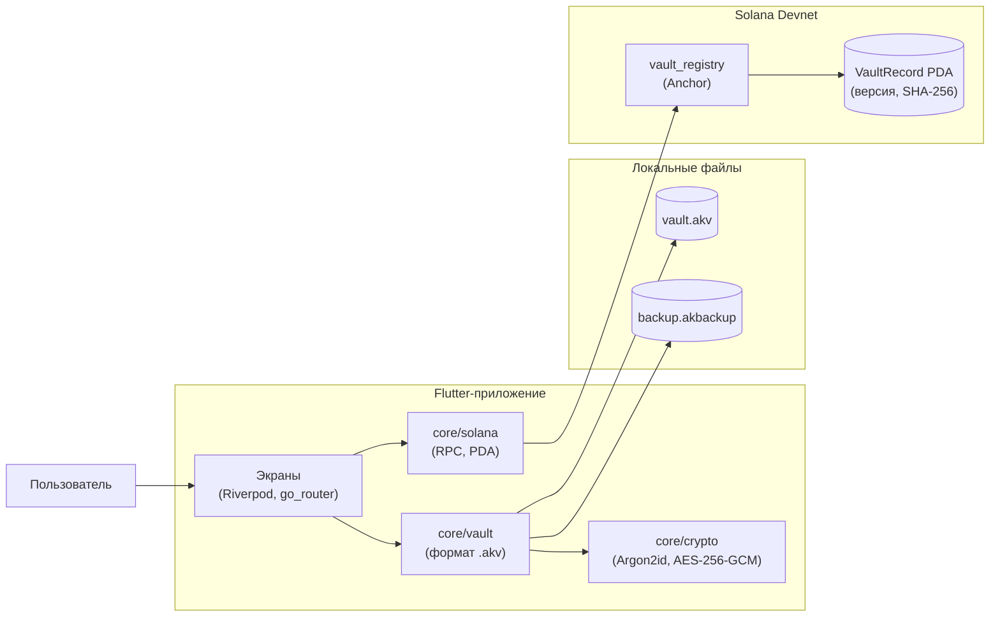

<div align="center">

<picture>
  <source media="(prefers-color-scheme: dark)" srcset="docs/branding/anchorkeep-mark-paper.svg">
  
</picture>

# Anchorkeep

**Офлайн-сейф для паролей и заметок с заверением бэкапов в Solana**


</div>

---

## Содержание

- [О проекте](#о-проекте)
- [Архитектура](#архитектура)
- [Возможности](#возможности)
- [Как работает проверка бэкапа](#как-работает-проверка-бэкапа)
- [Быстрый старт](#быстрый-старт)
- [Команды](#команды)

---

## О проекте

### Проблема

Облачные менеджеры паролей требуют доверять чужому серверу. У локальных другая
проблема: бэкап можно подменить или откатить на старую версию, и пользователь
этого не заметит. AES-GCM защищает от порчи данных, но не от отката к старому
валидному файлу.

### Решение

**Anchorkeep** хранит сейф локально, без регистрации и сервера. При каждом бэкапе
SHA-256 зашифрованного файла и номер версии записываются в Solana Devnet. При
восстановлении приложение сверяет файл с on-chain записью. Секреты в блокчейн
не попадают.

### Аудитория

- Технически грамотные пользователи, которые не хотят хранить пароли в облаке
- Те, кто переносит данные между телефоном и ПК через файл

Платформы MVP: **Android 8+ (API 26)** и **Windows 10+**.

---

## Архитектура



Подробное описание криптосхемы, формата файла и программы — в `docs/ARCHITECTURE.md`.

---

## Возможности

<div align="center">

| **Возможность** | **Для чего нужна** |
|:---|:---|
| Сейф и мастер-пароль | Argon2id + AES-256-GCM, пароль нигде не хранится и не восстанавливается |
| Пароли и заметки | CRUD записей, генератор паролей, копирование с очисткой буфера через 30 с |
| Поиск | По названию и URL среди паролей и заметок |
| Бэкап и восстановление | Экспорт и импорт зашифрованного файла `.akbackup` |
| Заверение версии | Хеш и номер версии бэкапа записываются в программу `vault_registry` |
| Проверка бэкапа | Статус Verified / Outdated / Unknown при импорте и по кнопке |
| Автоблокировка | По таймауту (5 мин по умолчанию) и при сворачивании приложения |

</div>

---

## Как работает проверка бэкапа

1. **Сохранить бэкап.** Приложение шифрует сейф и записывает `.akbackup` с номером ревизии.
2. **Заверить версию.** SHA-256 файла и номер версии уходят в PDA `["vault", owner, vault_id]`.
3. **Перенести файл.** Бэкап копируется на другое устройство любым способом.
4. **Проверить при импорте.** Хеш файла сравнивается с on-chain записью.

<div align="center">

| **Статус** | **Что значит** |
|:---|:---|
| ✅ Verified | Хеш совпадает — это последняя заверенная версия |
| ⚠️ Outdated | Ревизия файла старше on-chain версии — подсунули старый бэкап |
| ❌ Unknown | Файл не заверялся или изменён |
| ℹ️ Offline | Нет сети или записи в блокчейне |

</div>

---

## Быстрый старт

### Требования

<div align="center">

| Компонент | Версия |
| :-------: | :----: |
| Flutter | 3.47 stable |
| Rust | 1.89 |
| Solana CLI | 4.1.2 |
| Anchor (через `avm`) | 1.2.1 |
| Node.js + yarn | 24 + 1.22 |

</div>

Сборка программы — на macOS, Linux или WSL. Windows-сборка приложения — только на Windows.

### Клонирование репозитория

```bash
git clone https://github.com/S-NOWNUM-B/app.Anchorkeep.git

cd app.Anchorkeep
```

### Запуск приложения

```bash
# Установка зависимостей и запуск на Windows
cd app && flutter pub get && flutter run -d windows
```

### Сборка и тесты программы

```bash
# Установка зависимостей, сборка и тесты на локальном валидаторе
cd program && yarn install && anchor build && anchor test --validator legacy
```

---

## Команды

### Приложение (`app/`)

```bash
# Проверка форматирования
dart format --set-exit-if-changed .

# Статический анализ
flutter analyze --fatal-infos

# Тесты
flutter test

# Отладочная сборка APK
flutter build apk --debug
```

### Программа (`program/`)

```bash
# Сборка программы
anchor build

# Тесты на solana-test-validator
anchor test --validator legacy

# Деплой в devnet
anchor deploy --provider.cluster devnet
```
